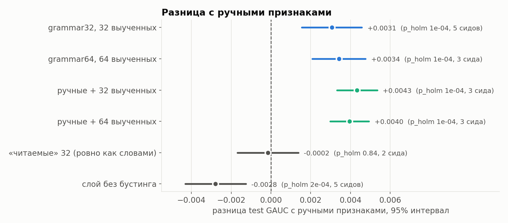
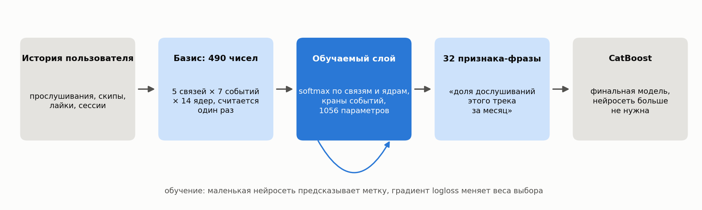
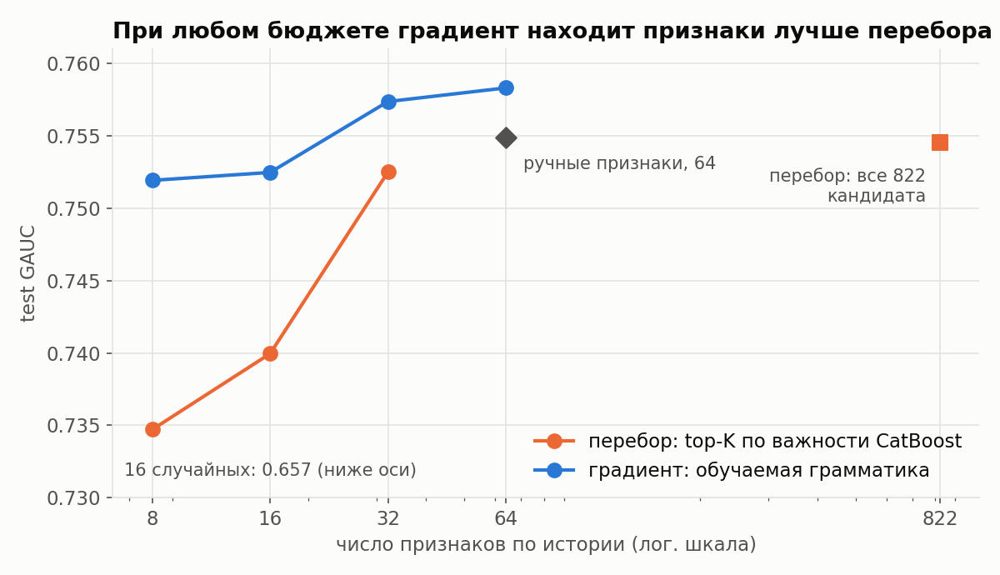
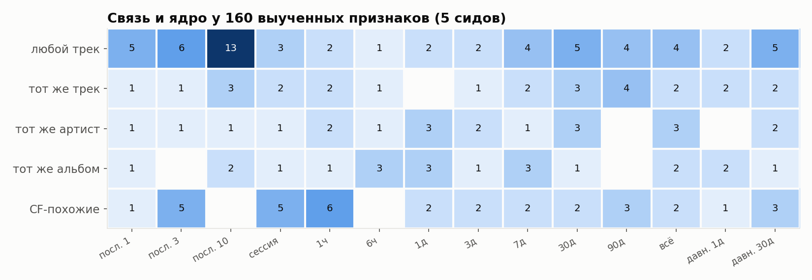
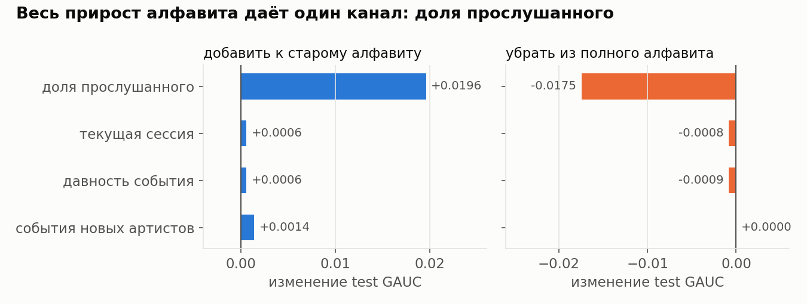
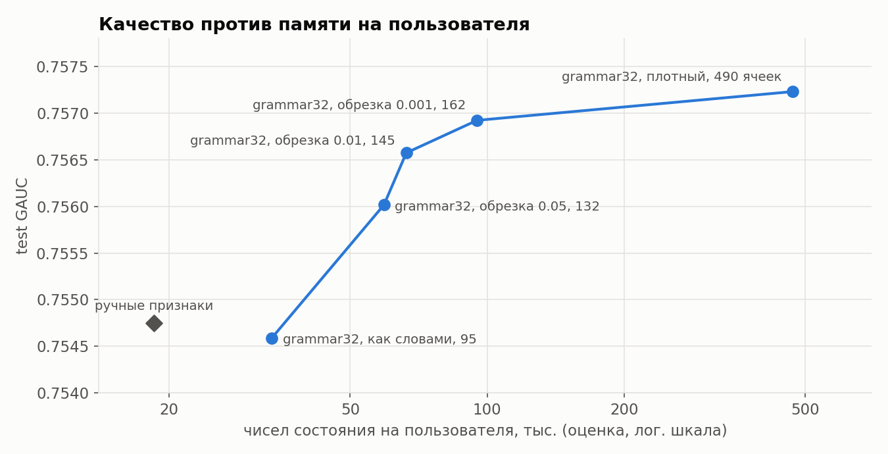

# Нейросеть как инженер признаков: обучаемая грамматика агрегатов для ранжирования

Задание T-Bank RecSys просит автоматизировать построение признаков для ранжирования или найти альтернативу сильному бустингу на ручных признаках. Мы автоматизируем признаки, но не перебором: **признаки выбирает градиент в явной грамматике агрегатов**, каждый признак читается как фраза, а финальной моделью остаётся CatBoost.

**Данные:** Yambda-50M, 10 тыс. пользователей, 47.8M событий.
**Задача:** предсказать, дослушает ли пользователь трек, который включил рекомендатель.
**Итоговый отчёт:** [`docs/REPORT.md`](docs/REPORT.md).

## Главный результат

| Признаки по истории у CatBoost | Сколько | Test GAUC | NDCG@10 | LogLoss |
|---|---|---|---|---|
| без истории | 0 | 0.5735 | 0.7859 | 0.5510 |
| перебор в духе OpenFE: top-32 по важности | 32 | 0.7525 | 0.8277 | 0.3295 |
| **ручные признаки (сильный бейзлайн)** | 64 | 0.7545 | 0.8314 | 0.3286 |
| **выученные градиентом** | 32 | **0.7576** | 0.8327 | 0.3292 |
| **выученные градиентом** | 64 | **0.7583** | **0.8341** | **0.3282** |
| **ручные + выученные** | 64 + 32 | **0.7592** | **0.8347** | **0.3269** |

- **64 выученных признака лучше 64 ручных по всем трём метрикам.** Выигрыш значим после поправки на множественные сравнения (перестановочный тест по пользователям, Холм) и повторяется на каждом сиде.
- **При равном числе признаков градиент обходит перебор** на +0.013–0.017 GAUC.
- **Выученные признаки дополняют ручные:** гибрид даёт +0.0043 GAUC и −0.0018 LogLoss.



## Идея за минуту

Почти любой ручной признак по истории, например «сколько раз пользователь слушал этого артиста за 30 дней» или «доля скипов за последние 3 трека», — это частный случай одной формулы:

```
признак = сумма по прошлым событиям пользователя:  [тип события] × [вес по давности] × [связь с кандидатом]
```

Человек выбирает каждую часть руками: окно 7 или 30 дней, артист или альбом. Перебор (OpenFE) перечисляет все сочетания и отбирает по важности. Мы делаем выбор **непрерывным**, по аналогии с поиском архитектур в DARTS:



1. **Базис.** Для каждого объекта заранее считаются 490 элементарных сумм:
   - **связь** — любой трек, тот же трек, тот же артист, тот же альбом или CF-похожие треки;
   - **событие** — дослушал или скипнул; рекомендация или сам нашёл; доля прослушанного; новый артист;
   - **ядро** — последние k треков, текущая сессия, экспонента с tau от часа до 90 дней, вся история, давность.
2. **Слой.** У каждого из K признаков есть веса по связям и ядрам (softmax) и «краны» событий в числителе и знаменателе (sigmoid). Признак — взвешенная сумма клеток базиса: счётчик `log(1 + x)` или сглаженная доля. Штраф на энтропию делает выбор почти дискретным.
3. **Обучение.** K признаков вместе с признаками трека и контекста идут в маленький MLP, который предсказывает дослушивание, loss — logloss. Слой учится на train, ранняя остановка по val, около 2 минут на T4.
4. **CatBoost.** Слой замораживается, его K выходов на train, val и test становятся колонками CatBoost, MLP выбрасывается.

Почему выбор признака становится обучаемым. Для признака k:

```
B[r, a, t]   базис объекта: связь r, событие a, ядро t (считается заранее, не обучается)
p = softmax(α_k)   веса связей         q = softmax(β_k)   веса ядер
n = σ(γ_k)         краны числителя     d = n + (1 - n)·σ(δ_k)   краны знаменателя (d >= n)

S(a)     = Σ_r Σ_t  p[r] · q[t] · B[r, a, t]
счётчик  = log(1 + Σ_a n[a]·S(a))
доля     = (Σ_a n[a]·S(a) + 0.5) / (Σ_a d[a]·S(a) + 1)
```

Ручной признак — частный случай: `p`, `q`, `n`, `d` равны 0 или 1. Например, «доля дослушиваний этого артиста за 30 дней» — это `p` на «тот же артист», `q` на «tau = 30 дней», `n` на «дослушал», `d` на «дослушал + скипнул». Перебор пробует такие варианты по одному, каждый раз обучая модель. У нас все операции гладкие по α, β, γ, δ, поэтому градиент logloss проходит через MLP и признак к весам выбора. За один проход обучения слой одновременно двигает все K признаков к тем связям, ядрам и событиям, которые полезны для предсказания.

Признаки учатся совместно, поэтому не дублируют друг друга. Перебор оценивает кандидатов поодиночке и набирает почти одинаковые признаки.



## Что выучилось и что дало прирост

Примеры выученных признаков (полные списки лежат в `outputs/*/outputs/grammar/features_k*.md`):

```
доля прослушанного + скипы по любым трекам, последние 3 трека    -> как прошли последние треки
доля дослушиваний этого трека, затухание 30 дней                  -> отношение к треку за месяц
скипы среди CF-похожих треков, последний час                      -> «похожее сейчас не заходит»
доля прослушанного этого трека в текущей сессии                   -> сколько его уже слушали сегодня
```

Модель сама нашла масштабы, которые совпали с EDA: для пользователя целиком короткие (последние треки, сессия, час), для пары с конкретным треком длинные (30–90 дней).



Абляция алфавита показала, что решает **один канал — непрерывная доля прослушанного** (`played_ratio` прошлых событий). Без него грамматика проигрывает ручным признакам (0.740 против 0.754), с ним выигрывает. Бинарное «дослушал на 50%» совпадает с меткой и теряет информацию: скип на 5% и скип на 45% говорят о разном.

Доля прослушанного есть и в ручном наборе, но только как одно последнее значение (`c_prev1_ratio`, `ui_last_ratio`). В грамматике это событие, которое можно агрегировать по любой связи и ядру, например «средняя доля прослушанного по последним 10 трекам» или «сумма долей по этому треку с затуханием 30 дней». Выигрыш дают именно такие агрегаты и их смеси. Если отдать CatBoost все клетки базиса напрямую, получится уровень ручных признаков (0.7545, на подвыборке 1M строк).

Канал «новые артисты» даёт признаки из топа важности CatBoost, но если убрать его из алфавита, качество не меняется: ту же информацию слой собирает из других событий. Поэтому вклад каналов мы проверяли абляцией, а не по важности.



## Цена и честные минусы

- **Память.** Плотный слой опирается на все 490 клеток и требует в 25 раз больше состояния на пользователя, чем ручные признаки. После обрезки весов до 162 клеток выигрыш сохраняется при 5× памяти.
- **Читаемость частичная.** Признаки ровно в виде фразы (одна связь, одно ядро) дают качество ручного набора, но не выигрыш. Выигрыш создают мягкие смеси нескольких ядер.
- **Скорость.** Строить базис в ~10 раз дороже, чем ручные признаки. Время растёт линейно по числу событий.
- **Метод ограничен алфавитом.** Новые оси задаёт человек, а абляция показывает, нужна ли новая ось.



## Как устроена проверка

- **Постановка.** Объект — прослушивание, которое включил рекомендатель (`is_organic = 0`). Метка — `played_ratio_pct >= 50`. Скипы логируются, поэтому негативы настоящие.
- **Разбиение по времени.** train 28 дней, val 7 дней, test 7 дней. Всё подбирается по val, затем модель переобучается на train+val, и test оценивается один раз.
- **Метрики.** LogLoss, AUC, GAUC (AUC внутри пользователя), NDCG@10 по группам «пользователь × день», срезы по новизне трека.
- **Без утечек.**
  - `timestamp` в Yambda — конец прослушивания. Поэтому момент запроса — конец предыдущего прослушивания, иначе разница времён выдаёт длительность текущего (такой признак даёт AUC 0.81).
  - Тест «отрезанного будущего»: признаки на данных, обрезанных в середине val, совпадают бит в бит по всем 584 признакам. Специально добавленная утечка-канарейка (`played_ratio` следующего события) ловится.
  - Признаки трека, артиста и альбома — снимок на начало суток. CF-факторы обучены по истории до начала train. Слой грамматики учится только на train.
- **Значимость.** Парный перестановочный тест по пользователям (100 000 перестановок), поправка Холма, MDE при мощности 0.8, 3–5 сидов.

## Документы

| Файл | Что внутри |
|---|---|
| [`docs/REPORT.md`](docs/REPORT.md) | **итоговый отчёт:** постановка, метод, все эксперименты, выводы, ограничения, литература |
| [`notebooks/01_eda.ipynb`](notebooks/01_eda.ipynb) | разведочный анализ данных |

## Проверить цифры

Веса моделей (`models/*.cbm`) и предсказания на test (`test_predictions.parquet`) лежат в архиве `artifacts.zip` в [**Releases**](https://github.com/softargmax/recsys_task/releases) этого репозитория. Его нужно распаковать в корень репозитория. Те же файлы есть в выводах Kaggle-ноутбуков (таблица ниже). Метрики, стат-тесты, веса слоя грамматики (`grammar/*.pt`) и выученные признаки словами уже лежат в `outputs/`.

```
pip install -r requirements.txt

python3 scripts/evaluate.py predictions
python3 scripts/evaluate.py weights --features data/yambda/derived/50m/features --seed 42
python3 scripts/make_figures.py
```

- **`predictions`** — пересчёт всех метрик и стат-тестов по сохранённым предсказаниям, около 30 с.
- **`weights`** — применение скачанных весов CatBoost и слоя к признакам test и сравнение с сохранёнными предсказаниями. Нужны признаки, см. ниже.
- **`make_figures.py`** — перерисовка графиков из `outputs/`.

## Воспроизвести с нуля

Нужен Python 3.12. Признакам нужно около 6 ГБ RAM, они считаются кусками по 1000 пользователей.

```
python3 scripts/download_yambda.py
python3 scripts/prepare_listens.py
python3 scripts/check_leakage.py
python3 scripts/build_features.py --basis --out data/yambda/derived/50m/features
python3 scripts/run_experiments.py --features data/yambda/derived/50m/features --task-type GPU
python3 scripts/run_discovery.py --features data/yambda/derived/50m/features --task-type GPU --device cuda
python3 scripts/run_seeds.py --features data/yambda/derived/50m/features --task-type GPU --device cuda
```

Так же запускаются `run_ablation.py`, `run_prune.py`, `run_sparse.py`, `run_scale.py`, `stat_tests.py` и `cost_report.py`.

Все эксперименты прогонялись на Kaggle (T4), на копии данных [`yambda-50m-flat`](https://www.kaggle.com/datasets/rabochi1024/yambda-50m-flat) (три файла `yandex/yambda`, Apache 2.0). Логи и выводы каждого прогона видны на странице ноутбука. Ноутбуки генерируются из того же кода командой `python3 kaggle/build_notebook.py <stage>`: модуль `rank/` вставляется в них ячейками `%%writefile`. Ноутбук `features` один раз строит признаки, остальные берут их из его вывода, если совпадает хеш кода признаков.

| Этап | Kaggle-ноутбук | Артефакты в `outputs/` |
|---|---|---|
| признаки и тест на утечки | [`yambda-features`](https://www.kaggle.com/code/rabochi1024/yambda-features) | кэш признаков |
| бейзлайн и счётчики с затуханием | [`yambda-catboost-baseline`](https://www.kaggle.com/code/rabochi1024/yambda-catboost-baseline) | `kaggle_v2` |
| человек / перебор / градиент | [`yambda-feature-discovery`](https://www.kaggle.com/code/rabochi1024/yambda-feature-discovery) | `kaggle_discovery_base`, `kaggle_discovery_rich` |
| 5 сидов и стат-тесты | [`yambda-grammar-seeds`](https://www.kaggle.com/code/rabochi1024/yambda-grammar-seeds) | `kaggle_seeds_v2` |
| абляция алфавита | [`yambda-grammar-ablation`](https://www.kaggle.com/code/rabochi1024/yambda-grammar-ablation) | `kaggle_ablation` |
| обрезка весов | [`yambda-grammar-prune`](https://www.kaggle.com/code/rabochi1024/yambda-grammar-prune) | `kaggle_prune` |
| дискретная грамматика | [`yambda-grammar-sparse`](https://www.kaggle.com/code/rabochi1024/yambda-grammar-sparse) | `kaggle_sparse` |
| 32 / 64 признака и гибриды | [`yambda-grammar-scale`](https://www.kaggle.com/code/rabochi1024/yambda-grammar-scale) | `kaggle_scale` |

<details>
<summary>Структура кода</summary>

```
rank/
    config.py           константы: окна разбиения, порог дослушивания, сглаживание
    prepare.py          построчные колонки прослушиваний (артист, альбом, номер повтора)
    windows.py          оконные суммы (накопленные суммы + searchsorted) и суммы с затуханием (logaddexp.accumulate)
    user_features.py    признаки по истории пользователя: окна, затухание, лайки, контекст сессии
    entity_features.py  признаки трека, артиста и альбома, снимок на начало суток
    cf.py               SVD-факторы по истории до начала train и похожесть кандидата на последние треки
    basis.py            базис грамматики: 5 связей x 7 событий x 14 ядер = 490 сумм на объект
    features.py         сборка: части по 1000 пользователей, join, разбиение, meta.json, хеш кода
    leakage.py          тест «отрезанного будущего» с канарейкой
    metrics.py          LogLoss, AUC, GAUC, NDCG@10, срезы по новизне, bootstrap по пользователям
    stats.py            парный перестановочный тест по пользователям, z-тест, MDE, поправка Холма
    train.py            CatBoost, логистическая регрессия, простые бейзлайны
    learned.py          обучаемый слой грамматики (torch) и описание признаков словами
    experiments.py      бейзлайн: наборы L0 / L0+cf / L1, ablation групп
    discovery.py        человек / перебор / случайные / градиент / гибрид
    seeds.py            5 сидов, стабильность выученных признаков
    alphabet.py         варианты алфавита по каналам
    ablation.py         абляция алфавита
    prune.py            обрезка весов и «читаемый» вариант
    sparse.py           дискретная грамматика (straight-through)
    scale.py            K = 32 / 64 и гибриды
    cost.py             затраты: время, инференс, память на пользователя
    evaluate.py         проверка цифр по предсказаниям или по весам
scripts/                точки входа
kaggle/                 метаданные датасета и генератор Kaggle-ноутбуков
outputs/                метрики, стат-тесты, выученные признаки и веса слоя всех прогонов
docs/                   отчёт и графики
```

</details>
